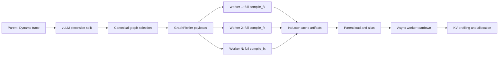

# Metadata-Aware Parallel FX Compilation

## Motivation

IgniteServe's vLLM backend partitions one model into multiple piecewise FX graphs. Structural metadata can reduce many pieces to a small set of canonical compile jobs, but stock PyTorch 2.7 does not expose a non-blocking API for compiling several complete FX graphs concurrently.

PyTorch's existing `FxCompileMode.SUBPROCESS` boundary is below AOTAutograd, at `fx_codegen_and_compile()`. Its stock caller submits one job and immediately waits for it. Increasing only that pool size therefore does not provide concurrent, end-to-end compilation of independent vLLM subgraphs.

Threading complete compilation in one Python process is unsafe. The path includes process-global or mutable state such as Dynamo's compile lock, the FX symbolic-trace patcher, FX traceback metadata, configuration patch stacks, and FakeTensor/dispatch state. The implementation deliberately preserves these protections and moves independent work to isolated processes.

## Architecture

The parent traces and partitions the model once, restores each subgraph's input metadata, and selects canonical graphs. `FullFxCompilePool.submit()` serializes each canonical GraphModule, FakeTensor/SymInt inputs, portable configuration, a clean tracing context, and optional worker context factories. All jobs are submitted before waiting.

Each worker:

1. imports requested framework/custom-op registration modules;
2. reconstructs FakeTensorMode, ShapeEnv, TracingContext, and graph metadata;
3. enters Dynamo metrics, inference, Inductor configuration, and integration contexts;
4. executes the complete `compile_fx -> AOTAutograd -> Inductor` path;
5. writes normal FX graph-cache artifacts atomically;
6. returns cache keys, artifact paths, compile timing, and worker identity.

The parent loads those artifacts and aliases structurally equivalent follower graphs. Worker shutdown starts asynchronously after the final compile result, then the serving process waits for complete teardown before KV-memory profiling so worker CUDA contexts cannot reduce the measured KV capacity.

## PyTorch Source Changes

### `torch/_inductor/compile_fx_full_subproc.py`

New complete-FX compilation API:

- persistent spawn-based process pool;
- non-blocking submission of independent jobs;
- worker prewarm and optional CUDA context pre-initialization;
- full GraphPickler payload transport;
- custom worker context factories;
- explicit normal-mode inner compilation to avoid nested subprocess pools;
- asynchronous begin/wait shutdown lifecycle;
- timing and cache-artifact metadata.

### `torch/fx/_graph_pickler.py`

- Accepts globally registered `torch.ops.*` namespaces. The receiver must import the extension that registers the operator before deserialization.
- Removes the runtime FakeTensorMode reference from a symbolic view's base metadata before pickling and restores it with the receiver's FakeTensorMode.

### `torch/_inductor/compile_fx_ext.py`

- Transports `post_grad_custom_pre_pass` and `post_grad_custom_post_pass`, which portable Inductor configuration intentionally omits.
- Lets GraphPickler determine wire transport support instead of treating every non-cacheable higher-order-op graph as non-serializable.

### `torch/_inductor/compile_fx_subproc.py`

- Adds configurable stock post-AOT workers.
- Imports required custom-op modules in workers.
- Constrains inner Inductor compile threads to prevent `graph_workers * compile_threads` oversubscription.

### `test/fx/test_graph_pickler.py`

Adds a symbolic FakeTensor view round-trip regression.

## Controls

| Variable | Default | Purpose |
|---|---:|---|
| `TORCHINDUCTOR_FULL_FX_COMPILE_WORKERS` | `1` | Number of complete-FX worker processes. |
| `TORCHINDUCTOR_FX_COMPILE_INNER_THREADS` | `1` | Inner Inductor compile threads in each graph worker. |
| `TORCHINDUCTOR_FX_COMPILE_WORKER_IMPORTS` | empty | Comma-separated modules imported before deserialization, such as custom-op registration packages. |
| `TORCHINDUCTOR_FX_COMPILE_PREWARM_CUDA` | unset | If true, initializes the worker's CUDA FakeTensor context during prewarm. |
| `TORCHINDUCTOR_GRAPH_PICKLER_PROFILE_DIR` | unset | Writes worker-local GraphPickler cProfile output for diagnosis. |
| `TORCHINDUCTOR_FX_COMPILE_WORKERS` | `1` | Worker count for PyTorch's existing post-AOT subprocess mode. |
| `TORCHINDUCTOR_CACHE_DIR` | PyTorch default | Shared Inductor cache used for worker artifacts. |
| `TRITON_CACHE_DIR` | Triton default | Shared Triton cache used by generated kernels. |

IgniteServe additionally gates its integration with `VLLM_ENABLE_SUBPROCESS_COMPILE=1`. Leave that switch unset for warm-cache startup so an unnecessary pool is not created.

## Measured Results

Validated setup: Llama-3-8B, FP16, TP=1, `max_model_len=2048`, `max_num_batched_tokens=2048`, one NVIDIA A100 PCIe 40 GB, four canonical jobs and 29 reused followers.

| Metric | 1 worker | 4 workers | Saving |
|---|---:|---:|---:|
| Canonical compile jobs | 4 | 4 | - |
| Materialization | 12.71 s | 10.49 s | 17.5% |
| Model Compilation | 28.4498 s | 26.1960 s | 7.9% |
| EngineCore Total Init | 36.1678 s | 33.9606 s | 6.1% |
| LLM construction | 43.9006 s | 41.3360 s | 5.8% |
| Available KV memory | 19.27 GiB | 19.27 GiB | unchanged |

The four worker compile times were 3.42, 3.60, 3.49, and 2.79 seconds in the same wall-time window, establishing real overlap.

After moving worker prewarm earlier, making teardown asynchronous, and prewarming CUDA/SymPy state used by GraphPickler, three materialization measurements fell to 5.18, 4.98, and 5.20 seconds, then the final retained GraphPickler optimization reduced median materialization from 5.18 to 4.27 seconds. A representative final run reported:

| Metric | Final value |
|---|---:|
| Materialization | 4.23 s |
| Model Compilation | 14.5824 s |
| EngineCore Total Init | 18.6148 s |
| LLM construction | 19.4890 s |
| KV-cache capacity | 157,520 tokens |

These are research measurements, not universal performance guarantees. They depend on model structure, canonical reuse, hardware, compiler cache state, and workload configuration.

## Correctness and Limitations

- The retained integration completed cold compilation, CUDA Graph capture, generation, warm artifact loading, and KV-capacity checks.
- The real-model matrix currently covers one Llama-3-8B configuration. Qwen, quantization, LoRA, TP/PP, multimodal, and broader symbolic-shape cases require further validation.
- The vLLM prototype can request `unsafe_force_cache=True` for selected HOP graphs. This is an integration policy, not a safe general default.
- Custom-op modules are trusted code and must be imported in every worker before graph restoration.
- Structure-only graph signatures are insufficient; the integration must include shape, dtype, constants, attributes, passes, and compiler configuration.
- Full PyTorch test suites were not run on the A100 server because the source checkout was not rebuilt and its environment lacks `pytest`/`expecttest`.
- This code uses private compiler APIs and must be rebased carefully for PyTorch versions newer than 2.7.
